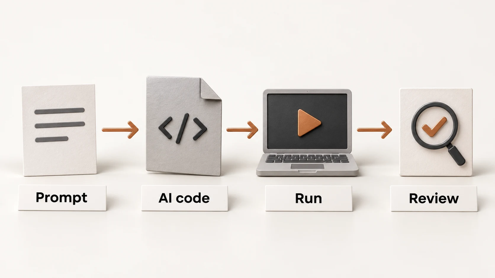

# Vibe coding AI for power electronics

**IEEE APEC 2027 Professional Educational Seminar**

Prompt an AI agent. Run its Python code in Google Colab. Review magnetic core-loss predictions using MagNet Challenge measurements.

## Before the session

Open the web app’s **Preparation** page. Have a **Google account**, **Google Colab**, and your preferred **AI agent** ready.

## What you’ll explore

- Correlations and data distributions
- Neural networks vs the generalized Steinmetz equation
- Feature preprocessing
- Longer training and validation-based checkpoint selection

> Full workshop opens ahead of IEEE APEC 2027.

**Available now:** Preparation, Overview, and previews of Lab and the completion badge.

Learning AI for Power Electronics from an Algorithmic Perspective: A Practitioner's Guide
